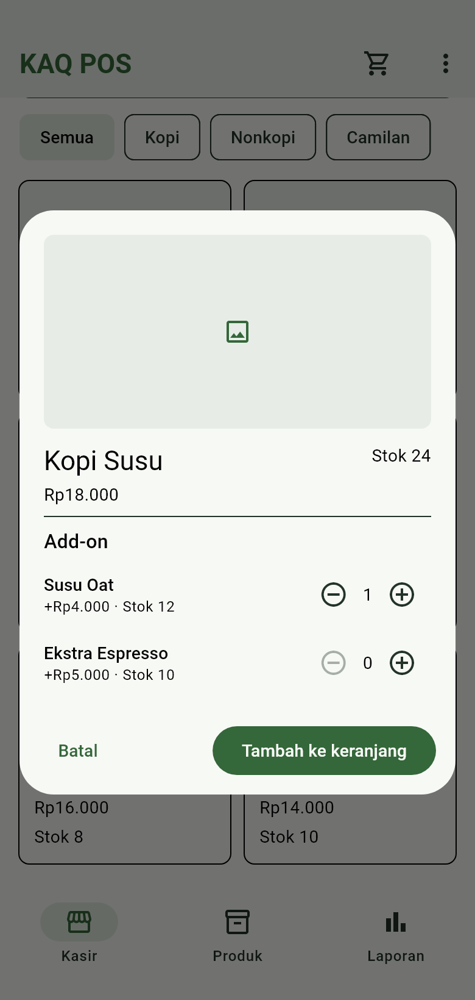
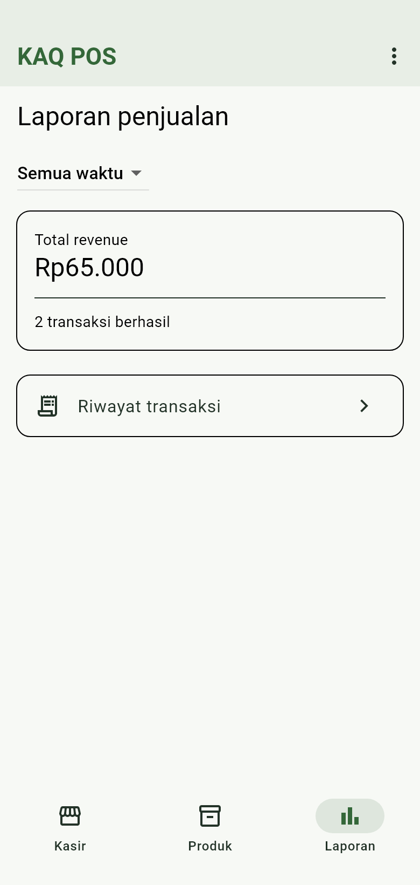
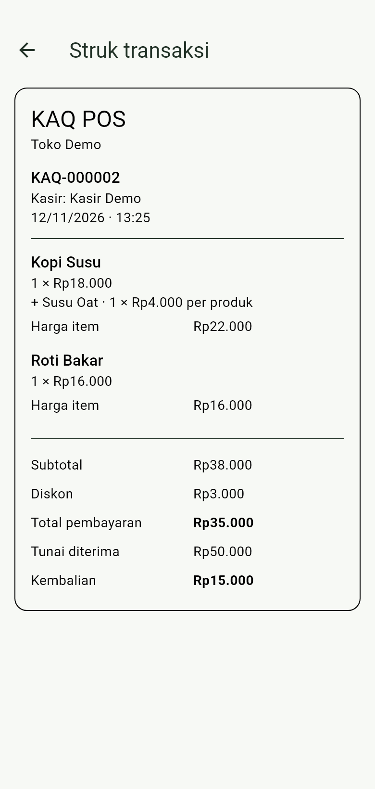
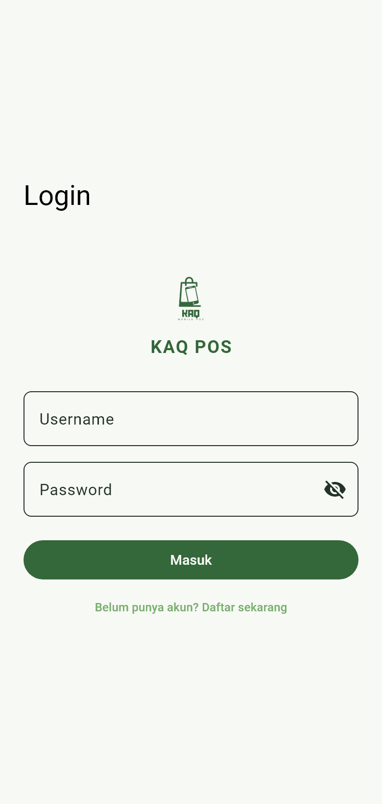

# KAQ POS

KAQ POS adalah aplikasi kasir berbasis Flutter untuk mengelola katalog dan stok, mencatat pesanan, serta memantau penjualan. Akun kasir, produk, dan transaksi disimpan di perangkat sehingga aktivitas kasir dapat berjalan secara offline.

## Fitur

- **Akun kasir** — registrasi, login, logout, dan pemulihan sesi saat aplikasi dibuka kembali.
- **Kasir** — pencarian produk, filter kategori, pemilihan add-on, dan keranjang dengan indikator jumlah unit.
- **Produk dan kategori** — tambah, ubah, dan hapus data. Foto produk dapat diambil dari kamera atau galeri. Produk dan add-on memiliki harga serta stok masing-masing.
- **Pembayaran tunai** — diskon dalam rupiah atau persen, perhitungan kembalian, dan pembaruan stok setelah transaksi berhasil.
- **Laporan penjualan** — total omzet dan jumlah transaksi berhasil untuk hari ini atau semua waktu, beserta riwayat dan struk digital.
- **Detail toko** — nama dan alamat toko dapat ditampilkan pada struk bersama nama kasir, waktu, item, add-on, diskon, dan pembayaran.

## Screenshot

Tangkapan layar berikut diambil dari tampilan aplikasi dengan data demo.

| Kasir | Dialog pesanan |
| --- | --- |
|  |  |

| Produk | Laporan penjualan |
| --- | --- |
|  |  |

| Struk transaksi | Login |
| --- | --- |
|  |  |

## Tech stack

| Teknologi | Penggunaan |
| --- | --- |
| Flutter dan Dart | Antarmuka dan logika aplikasi |
| GetX | Navigasi, autentikasi, dan injeksi dependensi |
| SQLite dengan `sqflite` | Penyimpanan lokal untuk akun, katalog, foto, stok, dan transaksi |
| `flutter_secure_storage` | Penyimpanan token sesi |
| `cryptography` | Hash kata sandi dengan PBKDF2-HMAC-SHA256 dan salt per akun |
| `image_picker` | Pemilihan foto dari kamera atau galeri |

## Struktur proyek

```text
lib/
├── main.dart             # Titik masuk dan konfigurasi aplikasi
├── binding/              # Registrasi database, repository, dan controller
├── data/
│   ├── database/         # Skema dan migrasi SQLite
│   ├── model/            # Model akun, katalog, keranjang, dan transaksi
│   └── repository/       # Akses data autentikasi dan penjualan
├── features/
│   ├── login/            # Splash, registrasi, dan login
│   ├── pos/              # Kasir, keranjang, pembayaran, dan navigasi utama
│   ├── products/         # Pengelolaan produk dan kategori
│   ├── report/           # Laporan, riwayat, dan struk
│   └── shared/           # Controller katalog, keranjang, dan penjualan
└── utils/                # Rute, tema, warna, dan validasi
assets/images/            # Aset gambar aplikasi
docs/screenshots/         # Tangkapan layar untuk dokumentasi
test/                     # Widget test alur aplikasi
```

## Setup dan menjalankan

### 1. Siapkan alat pengembangan

- Pasang Git dan Flutter SDK. Gunakan **Flutter 3.47.7** dengan **Dart 3.13.5** untuk mengikuti versi SDK yang digunakan dalam pengembangan proyek. Tambahkan direktori `flutter/bin` ke `PATH`. [Panduan instalasi Flutter](https://docs.flutter.dev/install)
- Untuk Android, pasang Android Studio dan siapkan **JDK 17** atau JBR bawaan yang kompatibel. Di SDK Manager, pasang **Android SDK Platform 36**, **Build-Tools 36.0.0**, **Platform-Tools**, **Command-line Tools**, dan **NDK (Side by side) 28.2.13676358**. Perangkat target memerlukan Android 7.0 atau lebih baru (API 24). [Panduan setup Android](https://docs.flutter.dev/platform-integration/android/setup)
- Untuk iOS, gunakan macOS dengan Xcode dan platform iOS terpasang. Target minimum proyek adalah iOS 15. Atur **Signing & Capabilities** pada target `Runner` di `ios/Runner.xcworkspace` bila memakai iPhone fisik. [Panduan setup iOS](https://docs.flutter.dev/platform-integration/ios/setup)

Periksa toolchain. Perintah lisensi hanya diperlukan untuk target Android.

```bash
flutter --version
flutter doctor -v
flutter doctor --android-licenses
```

### 2. Ambil proyek dan instal dependensi

```bash
git clone https://github.com/kasanindit/KAQ-POS-App.git
cd KAQ-POS-App
flutter pub get
```

Gradle Wrapper akan mengambil versi Gradle yang sesuai saat build Android pertama. Gunakan koneksi internet saat mengunduh SDK dan dependensi. Aplikasi menggunakan database lokal sehingga tidak memerlukan server, API key, atau file `.env`. File `android/local.properties` berisi lokasi SDK pada komputer masing-masing dan dibuat oleh Flutter saat menjalankan atau membangun aplikasi.

### 3. Jalankan di perangkat

Untuk Android, buka emulator atau hubungkan ponsel dengan **USB debugging** aktif. Untuk iOS, buka simulator atau hubungkan iPhone dengan **Developer Mode** aktif. Lihat ID perangkat yang terdeteksi, lalu ganti `<device-id>` dengan ID tersebut.

```bash
flutter devices
flutter run -d <device-id>
```

Pada instalasi pertama, pilih **Daftar sekarang** untuk membuat akun kasir lokal. Setelah masuk, buat kategori dan produk dari tab **Produk**, lalu coba catat pesanan dari tab **Kasir**. SQLite akan membuat file `kaq_pos.db` di penyimpanan aplikasi perangkat secara otomatis.

### 4. Buat APK debug untuk perangkat Android lain

```bash
flutter build apk --debug
```

File APK tersedia di `build/app/outputs/flutter-apk/app-debug.apk`. Salin ke perangkat Android tujuan untuk memasangnya.

## Pengujian

```bash
flutter analyze
flutter test
```
---

# Author
**Kasamira Anindita Qairia**  
Developed as part of the **Suitmedia Mobile Developer Technical Test**  
Linkedin: [Kasamira Anindita Qairia](https://www.linkedin.com/in/kasamira-anindita-qairia-9aa88524b/)
